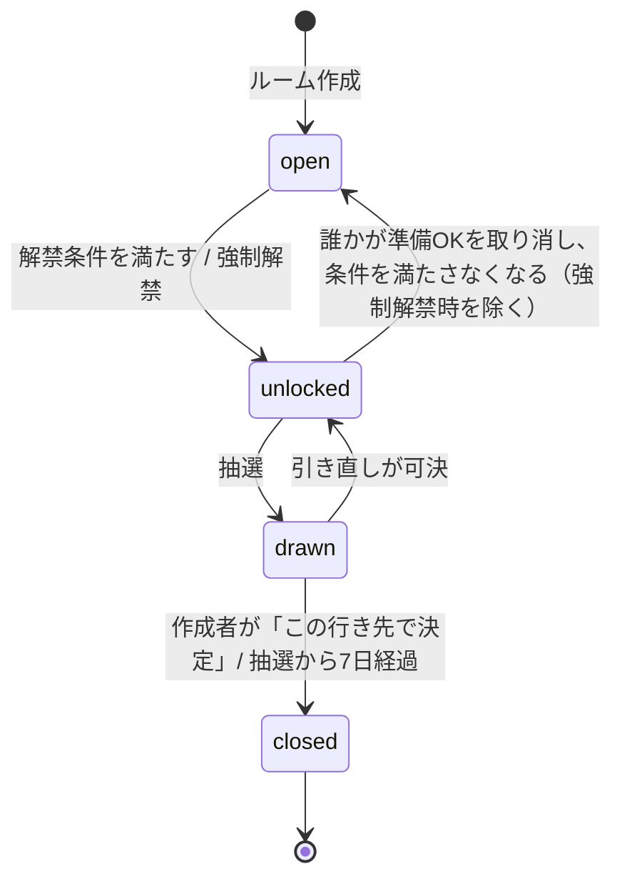

# 02 機能仕様

各機能に ID（`F-xx`）を振っています。受け入れ基準（AC）はテストと完了判定にそのまま使ってください。

---

## 0. 用語

| 用語 | 意味 |
|---|---|
| ルーム | 1回の旅行・おでかけ単位の使い捨てグループ。終わったらアーカイブされる |
| 作成者 | ルームを作った人。強制解禁などの権限を持つ |
| メンバー | ルームに参加している人（作成者を含む）。最大20人 |
| 候補 | メンバーが投稿した具体的な場所。ガチャのカプセル1個に相当 |
| いいね | 他人の候補への共感。共感ブーストモードでは出やすさが上がる |
| 準備OK | 「候補は出し終わった、回していいよ」という各メンバーの意思表示 |
| 解禁 | ガチャを回せる状態になること |
| 抽選 | ガチャを回して当選候補を1つ決めること |
| 当選 | 抽選で選ばれた候補。結果画面では「行き先きっぷ」として表示 |
| 外れた候補 | ルーム終了時に当選しなかった候補。次のルームに持ち込める |

---

## 1. ユーザーとアカウント（F-01）

- 初回起動時に **匿名ログイン**（Firebase Anonymous Auth）を行い、ユーザーIDを発行する
- 初回のみ **表示名** の入力を求める（1〜10文字、必須）。アバターは表示名の1文字目＋自動で割り当てた色
- アバター色は 04 の `avatar` パレットから、ルーム内でなるべく重ならないように割り当てる（仮決め：ユーザー作成時にランダムで1色を割り当て、ルーム内では重複しても可）
- 表示名は設定画面から変更できる
- 機種変更への対応として、設定画面から **Sign in with Apple に連携** できる（匿名アカウントをリンク）。MVP では「連携する」導線のみで、連携しなくても全機能を使える

**AC**
- [ ] 初回起動で表示名を入力すると、以降は入力なしでホームが開く
- [ ] アプリを削除せず再起動しても同じユーザーとして扱われる
- [ ] Sign in with Apple を連携すると、別端末で同じ Apple ID でサインインしたときに参加ルームが復元される

---

## 2. ルームのライフサイクル

### 2.1 状態遷移



| 状態 | 表示ラベル | できること |
|---|---|---|
| `open` | 候補募集中 | 候補の投稿・削除、いいね、準備OK、招待 |
| `unlocked` | ガチャ解禁！ | 上記すべて＋ガチャを回す |
| `drawn` | 行き先決定 | 結果の閲覧、引き直しの提案・投票、共有。候補の投稿・いいねは不可 |
| `closed` | 終了 | 閲覧のみ。外れた候補が「過去のアイデア」になる |

### 2.2 ルーム作成（F-02）

入力項目：

| 項目 | 仕様 | 初期値 |
|---|---|---|
| ルーム名 | 1〜20文字。必須 | 空欄（プレースホルダ「例：年末の旅行」） |
| 1人あたりの投稿数 | 1〜10件のステッパー | 3 |
| 解禁の条件 | 全員OK／過半数OK／締切日時 | 全員OK |
| 締切日時 | 解禁条件が「締切日時」のときだけ入力。現在から1時間後〜30日後 | 3日後の21:00 |
| いいねの効き方 | 共感ブースト／みんな平等 | 共感ブースト |

- 作成すると招待コード（後述）が発行され、招待画面へ進む
- 作成者は自動的にメンバーになる

**AC**
- [ ] ルーム名が空のときは「ルームを作成」が押せない
- [ ] 投稿数は1未満・10超にできない
- [ ] 作成直後のルームは `open`、メンバーは作成者1人

### 2.3 ルーム設定の変更（F-03）

作成者のみ、ルーム画面の設定から変更できる。

| 項目 | 変更ルール |
|---|---|
| ルーム名 | いつでも変更可（`closed` 以外） |
| 投稿数 | **引き上げのみ可**（下げられない） |
| 解禁の条件 | `open` のときのみ変更可 |
| いいねの効き方 | `open`/`unlocked` のときのみ変更可。変更するとメンバーに通知せず即時反映 |

### 2.4 招待と参加（F-04）

- 招待コード：英大文字と数字の6桁（紛らわしい `0 O 1 I` は使わない）。表示は `ABC-123` のように3桁ずつハイフン区切り
- 招待リンク：`https://dokogacha.app/r/{招待コード}`（ドメインは仮決め）。Universal Link でアプリが開き、そのルームの参加確認画面へ
- アプリ未インストールの場合は Web のランディングページを表示し、App Store へ誘導する。インストール後の自動参加（ディファードディープリンク）は MVP 対象外。ランディングページに招待コードを大きく表示し、アプリで入力してもらう
- 「招待コードで参加」画面でコードを入力して参加できる
- **前回のメンバーを招待**：自分が参加した直近の `closed` ルームのメンバー（自分以外）に、まとめてプッシュ通知で招待を送る
- **招待の入口**：ルーム画面のメンバーのアバターの右の「＋」（招待の画面をシートで開く）と、メンバー一覧の「招待する」。作成者に限らずメンバーなら誰でも招待できる。参加条件を満たさない状態（`drawn`/`closed`）では「＋」を出さず、満員（20人）のときは押せない（「＋」は「満員」の表示にする）
- 参加条件：ルームが `open` または `unlocked`、かつメンバーが20人未満
- 参加すると、そのメンバーの準備OKは `false` から始まる。**解禁済みのルームに新しい人が入ったら、解禁条件を再計算する**（強制解禁済みなら解禁のまま）

**AC**
- [ ] 正しいコードで参加でき、ルーム画面が開く
- [ ] 存在しないコードでは「招待コードが見つかりません」と表示
- [ ] 20人のルームに参加しようとすると「このルームは満員です（最大20人）」と表示
- [ ] `drawn`/`closed` のルームには参加できず「このルームはもう行き先が決まっています」と表示
- [ ] ルーム画面のアバターの右の「＋」から招待の画面を開ける。`drawn`/`closed` では「＋」が出ず、満員のときは押せない

### 2.5 退出・メンバー削除（F-05）

- メンバーはいつでも退出できる。退出した人の候補は残る（投稿者名は「退出したメンバー」と表示）。退出した人のいいねは取り消される
- 作成者はメンバーを削除できる（挙動は退出と同じ）
- 作成者は退出できない（MVP。ルームを終了することはできる）

### 2.6 アカウント削除（F-06）

- 設定画面の「アカウントを削除」から削除できる（App Store 審査で必須）
- 確認ダイアログ：「アカウントを削除すると、参加中のルームから退出し、元に戻せません」
- 削除時：参加中のルームから退出（F-05 と同じ処理）、作成者だったルームは `closed` にする、`users/{uid}` と `pastIdeas` を削除、Firebase Auth のユーザーを削除。投稿済みの候補は「退出したメンバー」の投稿として残す

---

## 3. 候補（F-10〜）

### 3.1 候補の投稿（F-10）

- 「場所を探す」タブで **MapKit の場所検索（`MKLocalSearch`）** を使って場所を選ぶ。自由入力の場所は MVP では不可
- 保存する情報：場所名、エリア表示（都道府県・市区町村。例「東京・豊島区」）、緯度経度、カテゴリ、MapKit の識別子（取得できる場合）
- 任意入力：ひとこと（最大40文字）、参考URL（1件）
- **投稿数の上限**：自分の投稿数がルームの上限に達していたら追加できない（ボタンを「上限」表示にして無効化）
- **重複**：同じ場所（MapKit の識別子が同じ、または場所名が同じで座標が100m以内）がすでにあるときは追加せず、「すでに候補にあります。いいねしますか？」と確認する。「いいねする」でその候補にいいね（自分の投稿だった場合はいいねせず閉じる）
- 投稿できるのは `open`/`unlocked` のときだけ

**カテゴリの対応表**（MapKit の `MKPointOfInterestCategory` → アプリのカテゴリ）

| アプリのカテゴリ | 表示名 | 主な MapKit カテゴリ |
|---|---|---|
| `aquarium` | 水族館 | `.aquarium` |
| `nature` | 自然 | `.park`, `.nationalPark`, `.campground` |
| `art` | アート・美術館 | `.museum` |
| `food` | グルメ | `.restaurant`, `.cafe`, `.bakery`, `.foodMarket`, `.brewery`, `.winery` |
| `activity` | アクティビティ | `.marina`, `.stadium`, `.fitnessCenter` |
| `park` | テーマパーク | `.amusementPark`, `.zoo` |
| `town` | 街歩き | `.store`, `.nightlife`, 該当なしのとき（既定） |
| `shrine` | 寺社 | （MapKit に該当なし。場所名に「神社」「寺」「宮」を含む場合） |
| `sea` | 海 | `.beach` |

※ 対応しきれない場合は `town` にする。投稿時にカテゴリを手で選び直せる（仮決め：選び直し UI は MVP に含める）。

### 3.2 候補の削除（F-11）

- 投稿者本人は、ルームが `open`/`unlocked` のときに自分の候補を削除できる。削除するとその候補へのいいねも消える
- 作成者は誰の候補でも削除できる

### 3.3 候補一覧の並び順（F-12）

- **新しい順**（投稿日時の降順）。最新の投稿が一番上
- 各候補に経過時間を表示：「たった今」（1分未満）／「◯分前」／「◯時間前」／「昨日」／「◯日前」（7日以上は「M/D」）
- **NEW バッジ**：自分が前回このルームを開いた時刻（`lastSeenAt`）より後に投稿された、他人の候補に付ける。ルーム画面を離れたときに `lastSeenAt` を更新する
- NEW が1件以上あるとき、一覧の上に「前回見たあとに N件の候補が増えました」と表示

### 3.4 過去のアイデア（F-13）

- 「候補を追加」画面の「過去のアイデア」タブに表示する
- 対象：**自分が参加した `closed` ルームの、当選しなかった候補**（自分以外の投稿も含む）
- ルームごとにまとめ、新しいルーム順に並べる。各グループの見出しに「ルーム名・日付・当選した場所（◯◯ ゆき）」
- 各候補に「前回 N いいね」を表示。前回のいいねが **3以上** なら「前回惜しかった」バッジ
- 「持ち込む」で現在のルームに自分の投稿として追加する（いいねは0から、投稿者は自分）。投稿数の上限と重複のルールは F-10 と同じ
- 引き直しで除外された候補（当選→引き直しで外れた候補）も「外れた候補」に含める

### 3.5 投稿の報告（F-14）

- 候補の詳細（S-10）の「…」メニューから「この投稿を報告」。理由（不適切な内容／スパム／その他）を選んで送信
- 報告は `reports` コレクションに保存し、運営がメールで受け取る（Functions からオーナーのアドレスに送信。仮決め）
- 報告した人の画面では、その候補のひとこととURLを非表示にする

---

## 4. いいねと出やすさ（F-20〜）

### 4.1 いいね（F-20）

- 1人1候補につき1いいね。もう一度押すと取り消し
- **自分の投稿にはいいねできない**（ボタンを無効化し「自分」と表示）
- いいねできるのは `open`/`unlocked` のときだけ
- 候補カードに **いいねした人のアバター（重ねて表示）と人数**（「N人がいいね」）を表示する。0件なら「まだいいねはありません」

### 4.2 出やすさの計算（F-21）

ルームのいいねモードで重みを決め、全候補の重みの合計で割って確率を出す。

```
重み(候補) = 1 + sqrt(いいね数)   … 共感ブースト
重み(候補) = 1                    … みんな平等
確率(候補) = 重み(候補) / Σ重み(全候補)
表示% = round(確率 × 100)   ※ 合計が100にならなくてもよい
```

例：いいね [4, 3, 3, 2, 2, 1, 1, 0] の8候補 → 重み [3.00, 2.73, 2.73, 2.41, 2.41, 2.00, 2.00, 1.00]、合計18.29 → 表示 [16, 15, 15, 13, 13, 11, 11, 5]%

### 4.3 出やすさのレベル表示（F-22）

平均確率（`100 / 候補数`）との比でラベルを決める。

| 条件（比 = 表示% ÷ 平均%） | ラベル | 色（04 参照） |
|---|---|---|
| みんな平等モード | 平等 | `level.flat` |
| 比 ≥ 1.2 | 出やすい | `level.high` |
| 0.85 ≤ 比 < 1.2 | ふつう | `level.mid` |
| 比 < 0.85 | レア | `level.low` |

- メーターの長さ = 表示% ÷ 全候補の中の最大の表示% × 100%（最大の候補が満タン）
- いいねの増減で、確率・ラベル・メーターをすべて即時に更新する（メーターは0.35秒でアニメーション）

### 4.4 人気の強調（F-23）

投稿者を除いたメンバー数を `n' = メンバー数 − 1` とする。

| 条件 | 表示 |
|---|---|
| いいね数 ≥ n'（かつ n' ≥ 2） | 「全員いいね」リボン＋強調カード |
| いいね数 ≥ ceil(n' × 0.6)（かついいね数 ≥ 2） | 「みんな推し」リボン＋強調カード |

強調カード：背景 `surface.highlight`、枠線 2.5pt、ハードシャドウ（04 参照）。人数の数字を `accent.text` 色にする。

**AC（F-20〜23）**
- [ ] いいねを押すと、その候補の人数・アバター・出やすさ%・ラベル・メーター、他の候補の%も更新される
- [ ] 自分の投稿のいいねボタンは押せない
- [ ] 5人のルームで、投稿者以外の3人がいいねした候補に「みんな推し」、4人なら「全員いいね」が付く
- [ ] みんな平等モードでは全候補が同じ%で「平等」ラベル

---

## 5. 準備OKと解禁（F-30〜）

### 5.1 準備OK（F-30）

- 各メンバーは「準備OK」をオン／オフできる（`open`/`unlocked` のとき）
- ルーム画面にメンバー全員のアバターを並べ、OKの人にはチェックバッジを付ける
- 7人以上のときはアバターを最大6人まで表示し、残りは「+N」で省略。人数は「OK 12/18人」の形式で常に表示

### 5.2 解禁条件（F-31）

| 条件 | 判定 |
|---|---|
| 全員OK | OK人数 = メンバー数 |
| 過半数OK | OK人数 > メンバー数 ÷ 2 |
| 締切日時 | 現在時刻 ≥ 締切日時（準備OKは参考表示のみ） |
| 強制解禁（共通） | 作成者が「強制解禁」を押した |

- 解禁の判定はサーバー側（Cloud Functions）でも行い、ルームの状態 `status` を更新する。クライアントはその値を表示に使う
- 締切日時の解禁は、スケジュール実行（5分ごと）でまとめて判定する（仮決め）
- 未解禁時のヒント文言：「全員OKで解禁 · あと N人」「過半数OKで解禁 · あと N人」「締切 M/D(曜) HH:MM に解禁されます」
- 解禁時：「条件を満たしました。誰が回してもOK！」／強制解禁時：「作成者が解禁しました。いつでも回せます」
- 解禁されたらメンバー全員にプッシュ通知（F-60）

### 5.3 強制解禁（F-32）

- 作成者だけに「強制解禁（作成者）」ボタンを表示（未解禁のとき）
- 押すと確認ダイアログ「まだ準備OKしていない人がいます。ガチャを解禁しますか？」→「解禁する」

**AC（F-30〜32）**
- [ ] 全員OK条件で、最後の1人がOKした瞬間に全員の画面が「ガチャ解禁！」になる
- [ ] 解禁後に誰かがOKを取り消すと `open` に戻る（強制解禁時は戻らない）
- [ ] 作成者以外には強制解禁ボタンが表示されない

---

## 6. ガチャと結果（F-40〜）

### 6.1 抽選（F-40）

- `unlocked` のとき、**メンバーなら誰でも** ガチャを回せる
- 抽選は **サーバー側（Cloud Functions の `drawGacha`）で実行** する。クライアントで乱数を引かない（不正防止と全員の結果を一致させるため）
- `drawGacha` の処理：
  1. ルームが `unlocked` であることをトランザクション内で確認（同時に2人が回しても抽選は1回だけ。2人目には既存の結果を返す）
  2. 除外リスト（引き直しで外れた候補）を除いた候補で、F-21 の重みに従って1件を選ぶ
  3. 抽選記録（当選候補、確率、全候補の重みのスナップショット、回した人、日時）を保存
  4. ルームを `drawn` にし、当選候補IDを書き込む
- 候補が0件のときは回せない（ボタンを無効化。「候補がありません」）

### 6.2 演出の同期（F-41）

- 回した人：レバーを押す → 筐体が揺れる演出（1.6秒）。この間に `drawGacha` を呼ぶ。結果が返り、かつ演出が終わったら、カプセルが取り出し口に落ちる
- 他のメンバー：ルームが `drawn` になったことをリアルタイムで受け取り、アプリを開いていればその場で「◯◯さんがガチャを回しました」と表示して同じ演出（揺れ → カプセル落下）を自動で再生する。アプリを開いていなかった人は、次に開いたときに結果画面（行き先きっぷ）を直接表示する
- カプセルをタップすると開く演出（0.5秒）→ 結果画面
- 通信エラー時：演出を止め「通信できませんでした。もう一度回してください」。ルームは `unlocked` のまま

### 6.3 結果（F-42）

- **行き先きっぷ** として表示：「◯◯ ゆき」、エリア・カテゴリ、ひとこと、投稿者、いいね数、当選確率、「決定」スタンプ（抽選日 `M.DD`）
- **レア当選**：当選確率 < 平均確率 × 0.85 のとき「レア当選」バッジを表示
- 操作：
  - **マップで開く**：Apple マップで当選場所を開く（`MKMapItem.openInMaps`）
  - **きっぷを共有**：行き先きっぷを画像にして共有シートで送る（`ImageRenderer` で生成）。画像にはアプリ名と App Store のURL（仮）を入れる
  - **引き直しを提案**（F-43）
  - **この行き先で決定**（作成者のみ）：ルームを `closed` にしてホームへ。作成者以外には「作成者が決定するとルームが終了します」と表示

### 6.4 引き直し（F-43）

- ルームにつき **1回まで**
- `drawn` のとき、メンバーの誰かが「引き直しを提案」→ 全メンバーに通知し、結果画面に投票UI（賛成／反対）を表示
- 提案者は自動で賛成
- **賛成が過半数（> メンバー数 ÷ 2）** になったら可決：直前の当選候補を除外リストに追加し、ルームを `unlocked` に戻す（準備OKはやり直さない）。結果画面に「過半数が賛成。もう一度引けます」
- 提案から24時間で過半数に届かなければ否決（仮決め）。否決後は再提案できない（1回の権利を消費）
- 表示：「引き直しを提案（過半数の賛成で1回まで）」／投票中「賛成を集めています…（N/M人）」／使用済み「引き直しは使用済みです」

### 6.5 ルームの終了（F-44）

- 作成者が「この行き先で決定」を押す、または抽選から7日経過で自動的に `closed`
- `closed` になったら、当選以外の候補を、参加していた各メンバーの「過去のアイデア」に登録する（F-13）
- ホームの「思い出のきっぷ」に、ルーム名・日付・当選場所を表示

**AC（F-40〜44）**
- [ ] 2人がほぼ同時にレバーを押しても、当選は1件だけで、全員に同じ結果が表示される
- [ ] いいねが多い候補ほど当選しやすい（共感ブースト時。抽選ロジックの単体テストで、1万回試行した当選率が理論値±2%以内）
- [ ] アプリを閉じていたメンバーが後から開くと、結果画面が表示される
- [ ] 引き直しが可決すると、前回の当選候補は次の抽選の対象から外れる
- [ ] 引き直しは2回目を提案できない

---

## 7. 広告と課金（F-50〜）

### 7.1 バナー広告（F-50）

- Google Mobile Ads（AdMob）のアンカー型アダプティブバナー
- 表示する画面：**ホーム**、**ルーム**、**候補を追加** の最下部のみ
- **表示しない画面**：ルーム作成、招待、ガチャ、結果、設定、オンボーディング。全画面広告（インタースティシャル）・リワード広告は使わない
- ATT（App Tracking Transparency）の許可ダイアログは、初回にルームに入ったあと（オンボーディング中ではない）に表示。拒否された場合は非パーソナライズ広告

### 7.2 広告非表示の買い切り（F-51）

- StoreKit 2 の非消耗型アイテム `remove_ads`（価格は仮決め ¥480）
- 購入すると、購入者本人は全画面で広告が消える
- **購入者がメンバーにいるルームでは、そのルームの全メンバーの広告が消える**。ルーム画面の最下部に「（王冠アイコン）◯◯さんのおかげで、このルームは広告なし」を表示（購入者が複数いる場合は最初に参加した人の名前）
- ホーム画面の広告は「自分が購入者か」だけで決める（ルームの購入者は関係しない）
- 購入状態はサーバーで検証してユーザーに記録する（05 参照）
- 設定画面に「広告を非表示にする（¥480）」「購入を復元」

**AC（F-50〜51）**
- [ ] 未購入ユーザーは、ホーム・ルーム・候補を追加の画面下部にバナーが出る。ガチャ・結果では出ない
- [ ] 購入者がいるルームでは、未購入のメンバーにも広告が出ず、購入者名のメッセージが出る
- [ ] 購入を復元すると広告が消える

---

## 8. 通知（F-60）

プッシュ通知（FCM 経由の APNs）。送るタイミング：

| イベント | 宛先 | 文面 |
|---|---|---|
| ガチャ解禁 | 全メンバー | 「{ルーム名}」のガチャが解禁されました！ |
| 抽選結果 | 回した人以外 | 「{ルーム名}」の行き先が決まりました |
| 引き直し提案 | 提案者以外 | {名前}さんが引き直しを提案しています |
| 前回のメンバーへの招待 | 招待された人 | {名前}さんから「{ルーム名}」に招待されました |
| 新しい候補（まとめ） | 全メンバー | 「{ルーム名}」に新しい候補が N件増えました（同じルームにつき最大1日1回） |

- 通知をタップすると該当ルーム（結果があれば結果画面）を開く
- 通知の許可ダイアログは、初めてルームを作成または参加したときに表示

---

## 9. 非機能要件

| 項目 | 要件 |
|---|---|
| 対応OS | iOS 17.0 以上。iPhone（縦向き固定）と iPad（すべての向き。Split View・Stage Manager などでウィンドウの大きさが変わっても崩れない。画面の組み方は 03 の §3「iPad」） |
| 言語 | 日本語のみ（文字列はローカライズ可能な形で持つ） |
| 人数 | 1ルーム最大20人、候補は最大200件（20人×10件） |
| リアルタイム性 | いいね・準備OK・抽選結果は、他メンバーの画面に2秒以内に反映 |
| オフライン | 閲覧はキャッシュで可能。投稿・いいね・準備OK・抽選はオンライン必須。オフライン時は「オフラインです」バナー |
| アクセシビリティ | VoiceOver ラベル、Dynamic Type（最大 xxxLarge まで崩れない）、「視差効果を減らす」設定時は揺れ・落下アニメーションを無効化し即時表示 |
| プライバシー | 位置情報は使わない（場所検索は全国か、利用者が選んだ地方・都道府県・市区町村の範囲で検索する。仮決め）。収集するのは表示名・投稿内容・端末の通知トークンのみ |

---

## 10. MVP の対象外（やらないこと）

- Android 版、Web 版アプリ（iPad は Issue #156 で対応した）
- ディファードディープリンク（未インストールからの自動参加）
- 写真の投稿、チャット、コメント
- 現在地からの距離表示、条件での絞り込み抽選
- 全員で同時にレバーを回すリアルタイム演出（SharePlay）
- 筐体のスキン変更、思い出図鑑（写真つきの記録）
- 英語などの多言語対応
