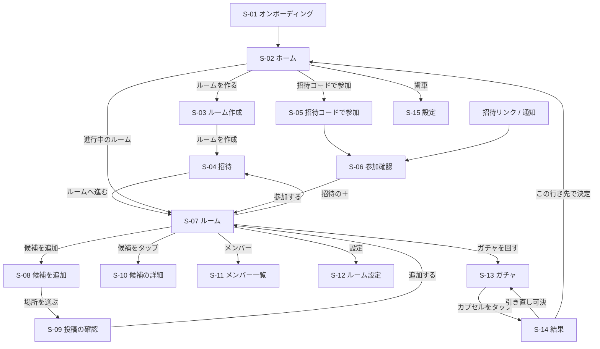

# 03 画面仕様

寸法は iPhone 15（390×844pt）基準です。色・フォント・部品名は [04_design_system.md](04_design_system.md) の名前を使っています。
`★` が付いた画面はプロトタイプ（`design/prototype/Main.dc.html`）にあります。見た目はプロトタイプに合わせてください。

---

## 1. 画面一覧

| ID | 画面 | 表示形式 | プロトタイプ |
|---|---|---|---|
| S-01 | オンボーディング（表示名の入力） | 全画面 | なし |
| S-02 | ホーム | ルート | ★ |
| S-03 | ルーム作成 | プッシュ | ★ |
| S-04 | 招待 | プッシュ（戻るとルーム）。ルームの「＋」からはシート | ★ |
| S-05 | 招待コードで参加 | シート | なし |
| S-06 | 参加確認 | シート | なし |
| S-07 | ルーム | プッシュ | ★ |
| S-08 | 候補を追加（場所を探す／過去のアイデア） | プッシュ | ★ |
| S-09 | 投稿の確認（ひとこと・URL・カテゴリ） | シート（ハーフ） | なし |
| S-10 | 候補の詳細 | シート | なし |
| S-11 | メンバー一覧 | シート | なし |
| S-12 | ルーム設定（作成者のみ） | シート | なし |
| S-13 | ガチャ | フルスクリーンカバー | ★ |
| S-14 | 結果（行き先きっぷ） | フルスクリーンカバー | ★ |
| S-15 | 設定 | プッシュ | なし |

## 2. 画面遷移

- ナビゲーションは `NavigationStack`。ガチャと結果は `fullScreenCover`
- ルームが `drawn` の状態でルーム画面を開いたら、結果画面を自動で表示する
- ルームが `closed` の場合、ホームの「思い出のきっぷ」から開くと結果画面（閲覧のみ）を表示する

## 3. 共通

- 背景は `bg.base`。ナビゲーションバーは標準のものを使わず、各画面の上部に **ヘッダー**（高さ60pt：戻るボタン44×44＋タイトル（見出しフォント18pt）＋右側の要素）を置く
- **バナー広告**（F-50）は画面最下部、セーフエリアの上に固定。高さはアダプティブバナーに従う（目安50pt）。左右16pt、下14pt の余白
- **トースト**：画面下から150ptの位置に表示し、2.2秒で消える（部品 `Toast`）
- 確認ダイアログは標準の `confirmationDialog` / `alert` を使う
- 読み込み中は部品の形を保ったまま `redacted(reason: .placeholder)` を使う

### iPad

iPad はすべての向きに対応し、Split View・Stage Manager でウィンドウの大きさが変わっても崩さない（02 の §9）。iPhone の画面（上の各画面の寸法）はそのまま使い、広い画面では次のように組む（寸法は 04 の §3 の `layout`）。

- **本文の列**：本文・ヘッダー・下部に固定するボタン・バナー広告は、最大幅 600（左右の余白 16 を除く）の列に収めて中央に寄せる。背景と、下部のバーの上の線は画面の幅いっぱいに塗る。スクロールは画面の幅いっぱいで受ける
- **2 列に分ける画面**（横の size class が regular で、列の最小の幅 358（iPhone 15 の本文の幅）が取れるとき。本文の最大幅は 1000。iPad mini の縦は 1 列）
  - S-02 ホーム：左に「進行中のルーム」、右に「思い出のきっぷ」を並べる（画面の幅 772 から）。下部のボタンは本文の列（600）のまま
  - S-07 ルーム：左の列（幅 360）にルームパネル・「ガチャを回す」・バナー広告、右の列に候補の見出し行と CandidateCard を並べ、それぞれでスクロールする（画面の幅 782 から）。候補を見ている間も準備OKの状態と「ガチャを回す」が見える
- **縦の中央に寄せる画面**：S-01・S-04（作った直後。ルームの「＋」からのシートは寄せない）・S-13・S-14 は、横・縦の size class がどちらも regular で中身が画面より低いとき、縦の中央に寄せる（iPadOS 18 以上）
- **シート**：iPad の標準（フォームシート）で出す。中身は本文の列に収める
- **トースト**：長い文言は本文の最大幅で折り返す

---

## S-01 オンボーディング

上から：
1. ロゴ（カプセルアイコン34pt＋「ドコガチャ」見出し32pt）とサブタイトル「友達旅行・おでかけの行き先ガチャ」
2. 説明3行（アイコン付きのリスト）：「行きたい場所を持ち寄る」「いいねで出やすさアップ」「揃ったらガチャで決定！」
3. 入力欄「表示名」（プレースホルダ「例：ゆい」、1〜10文字）。補足「ルームのメンバーに表示されます」
4. ボタン（PrimaryButton）「はじめる」：入力が空のときは無効

---

## S-02 ホーム ★

上から：
1. **ロゴエリア**：カプセルアイコン＋「ドコガチャ」（見出し32pt）、サブタイトル（本文13pt bold、`text.secondary`）。右上に点線の道のりとピンのイラスト（装飾、`design/icons/route-deco.svg`）。右上端に設定（歯車）ボタン 44×44
2. **進行中のルーム**（見出し16pt）：ルームごとに **RoomTagCard**（荷札風カード）を縦に並べる
   - 状態チップ（候補募集中／ガチャ解禁！）、ルーム名（本文18pt bold）、**DestinationBoard**（「行き先 ？？？」＋「カプセル N個」）、メンバーのアバター（28pt）＋「準備OK n/m人」
   - タップでルーム画面へ
   - 0件のとき：「まだルームがありません。ルームを作って友だちを招待しよう」
3. **思い出のきっぷ**（見出し16pt）：`closed` ルームを新しい順に **TicketStub**（ルーム名・日付、「◯◯ ゆき」、「外れた候補 N件は次のルームで使えます」、右端に「済」スタンプ）。タップで結果画面（閲覧のみ）。最大5件表示＋「すべて見る」
4. 下部固定：PrimaryButton「＋ ルームを作る」、SecondaryButton「招待コードで参加」
5. バナー広告

---

## S-03 ルーム作成 ★

ヘッダー：戻る＋「ルームを作る」

フォーム（上から、間隔22pt）：
1. 「どんなおでかけ？」＋テキスト入力（高さ52pt、プレースホルダ「例：年末の旅行」）
2. 「1人あたりの投稿数」＋ **Stepper**（−／「3 件まで」／＋）。補足「1〜10件。作成後は引き上げのみできます」
3. 「ガチャ解禁の条件」＋ **SegmentedChoice**（3択：全員OK／過半数OK／締切日時）。「締切日時」選択時は下に日時ピッカーを表示。補足「作成者はいつでも強制解禁できます」
4. 「いいねの効き方」＋ SegmentedChoice（2択：共感ブースト／みんな平等）。補足は選択に応じて切り替え
   - 共感ブースト：「いいねが多い候補ほど出やすくなります（いいね0でも当たります）」
   - みんな平等：「どの候補も同じ確率で出ます」

下部固定：PrimaryButton「ルームを作成」

---

## S-04 招待 ★

1. 「ルームを作成しました」（13pt）＋ルーム名（見出し24pt）
2. **招待コードカード**：「招待コード」、コード（見出し36pt、字間0.12em。例 `DK7-29Q`）、「最大20人まで参加できます」。コード部分を長押しでコピー
3. PrimaryButton「招待リンクを送る」：共有シートで以下を送る
   > 「{ルーム名}」で行き先ガチャやろう！行きたい場所を投稿してね
   > https://dokogacha.app/r/{コード}
4. SecondaryButton「前回のメンバー（{前回ルーム名}・N人）を招待」：前回ルームがあるときだけ表示。押すとトースト「前回のメンバーN人に招待を送りました」
5. 下部：DarkButton「ルームへ進む」

ルームの「＋」（S-07）から開いたとき（シート）：ヘッダー（「メンバーを招待」＋右端に閉じる）を置き、1 の「ルームを作成しました」と 5 の「ルームへ進む」は出さない（ルーム名・2〜4 は同じ。3・4 は下部に固定）。閉じるとルームに戻る

---

## S-05 招待コードで参加

- 6文字のコード入力（ハイフンは自動挿入、英大文字に自動変換、貼り付け対応）
- PrimaryButton「参加する」→ S-06
- エラー文言は F-04 の AC のとおり

## S-06 参加確認

- ルーム名、作成者名、メンバー数、候補数、状態チップ
- PrimaryButton「参加する」、テキストボタン「やめる」
- すでにメンバーなら確認を出さずにルーム画面へ

---

## S-07 ルーム ★

ヘッダー：戻る＋ルーム名（見出し18pt）＋状態チップ＋（作成者のみ）設定ボタン

スクロール領域（左右16pt、間隔14pt）：

1. **ルームパネル**（枠2.5pt、ハードシャドウ、角丸20）
   - 上部：**DestinationBoard**（黒帯）「行き先 ？？？ ／ カプセル N個」
   - 「準備OK」＋右端に「n/m」（見出し20pt）
   - メンバーのアバター（44pt＋名前11pt、OKならチェックバッジ）。7人以上は6人＋「+N」。タップでメンバー一覧
   - アバターの並びの末尾（「+N」の後）に招待の「＋」（アバターと同じ44pt の円、2pt ink の点線の縁、下に「招待」11pt）。タップで S-04 をシートで開く（触覚 `.impact(.light)`）。メンバー全員に出す。`open`/`unlocked` のときだけ出し、満員（20人）のときは押せない（円を `surface.disabled` で塗り、下を「満員」にする）。幅に入らなければアバターと同じく折り返す
   - ヒント文言（F-31）
   - ボタン：「準備OK」（オフ時：背景 `accent.secondary`）／「準備OKを取り消す」（オン時：背景白）。作成者かつ未解禁なら横に「強制解禁（作成者）」テキストボタン
   - 「あなたの投稿 n/上限件 · 共感ブースト（またはみんな平等）」
2. **候補の見出し行**：「候補」（見出し17pt）、「N件 · 新しい順」、右端に「＋ 候補を追加」ボタン（背景 `accent.secondary`、高さ40）
3. NEW がある場合：「前回見たあとに N件の候補が増えました」（12pt bold、`accent.text`）
4. **CandidateCard** を新しい順に並べる（04 の部品仕様）

下部固定：
- **GachaCTA**：解禁時「ガチャを回す」（背景 `accent.primary`、白文字）／未解禁時「準備OKが揃うと回せます」（無効、背景 `surface.disabled`）
- バナー広告、または「◯◯さんのおかげで、このルームは広告なし」（AdFreeNotice）

空の状態（候補0件）：カプセルのイラスト＋「まだ候補がありません。行きたい場所を投稿しよう！」＋「候補を追加」ボタン

---

## S-08 候補を追加 ★

ヘッダー：戻る＋「行きたい場所を追加」＋右端に「n/上限」

タブ（**TabSwitch**、2択）：「場所を探す」「過去のアイデア」

### 場所を探す
1. 検索欄（虫めがねアイコン＋入力、高さ48pt、プレースホルダ「水族館、高尾山 など」）。入力から0.3秒後に `MKLocalSearch` を実行
2. **クイックカテゴリ**（チップ）：水族館／自然／グルメ／テーマパーク／街歩き。押すとその語で検索
3. 検索結果を **PlaceRow**（カテゴリタイル42pt、場所名、「エリア · カテゴリ」、右に「追加」ボタン）で表示。状態により「追加済み」「上限」（無効）
4. 「追加」→ S-09
5. 結果0件：「見つかりませんでした」。地方を選んでいるときは「{地方}では見つかりませんでした」と「全国で探す」ボタン（押すと全国にして検索し直す）
6. **エリア**（チップ。検索欄とクイックカテゴリのあいだ、先頭に「エリア」の見出し）：全国／北海道／東北／関東／中部／関西／中国・四国／九州／沖縄。選んだエリアの範囲で検索し、押すと今の語で検索し直す。選んだエリアは端末に覚える（初めは全国）

### 過去のアイデア
1. ルームごとの見出し（黒帯）：「{ルーム名} {M/D}」＋右に「{当選場所} ゆき」
2. 補足：「このとき当たらなかった候補です。今回もう一度入れられます」
3. PlaceRow（「前回 N いいね」、3以上で「前回惜しかった」バッジ）、右に「持ち込む」→ S-09
4. 0件：「過去のアイデアはまだありません。ルームが終わると、外れた候補がここに貯まります」

下部：バナー広告

---

## S-09 投稿の確認（ハーフシート）

- 場所名、エリア、カテゴリタイル、小さな地図（`Map` で1ピン、高さ140pt）
- カテゴリ（自動判定済み、タップで9種から選び直し）
- 「ひとこと（任意）」40文字まで。プレースホルダ「例：天空のペンギン見たい！」
- 「参考URL（任意）」
- PrimaryButton「候補に追加」→ シートを閉じてルーム画面へ戻り、トースト「候補に追加しました」（持ち込み時は「過去のアイデアを持ち込みました」）

## S-10 候補の詳細

- CandidateCard と同じ情報＋地図（高さ200pt）、参考URL（タップで Safari）、いいねした人の名前一覧
- 「マップで開く」、自分の投稿（または作成者）なら「この候補を削除」（確認ダイアログ）
- 右上の「…」メニュー：他人の投稿なら「この投稿を報告」（F-14）

## S-11 メンバー一覧

- アバター・名前・準備OKの状態・投稿数。作成者に「作成者」ラベル
- 作成者は各メンバーをスワイプで削除
- 下部：「招待する」（S-04 と同じ共有。`drawn`/`closed` と満員のときは押せない）、自分が作成者以外なら「ルームから退出」

## S-12 ルーム設定（作成者のみ）

- ルーム名、投稿数（現在値未満は選べない）、解禁の条件（`open` のみ変更可）、いいねの効き方
- 「ルームを終了する」（確認：「ルームを終了すると、候補の投稿やガチャができなくなります」）

---

## S-13 ガチャ ★

ヘッダー：閉じる（戻る矢印）＋ルーム名

中央（上から）：
1. タイトル（見出し24pt）とサブ文言（13pt）。状態ごとに切り替え

   | 状態 | タイトル | サブ文言 |
   |---|---|---|
   | 待機 | レバーを回してね | 結果はメンバー全員の画面に同時に出ます（引き直し時：引き直し（前回の当選は除外）） |
   | 回転中 | ガラガラ… | どこに決まるかな |
   | 取り出し | カプセルをタップ！ | 開けると行き先が決まります |
   | 他の人が回した | {名前}さんが回しました！ | どこに決まるかな |

2. **GachaMachine**（04 の部品仕様）：ドーム（直径250）＋本体（280×210）。ドームには候補の数だけカプセルを入れる（最大50個まで描画）
3. 「カプセル N個 · 共感ブースト」（13pt）

操作：
- レバー（直径96のボタン）を押す → 回転中（1.6秒）→ 取り出し → カプセルをタップ → 開く（0.5秒）→ S-14
- 回転中・取り出し中はレバーを無効化
- 触覚フィードバック：レバーを押した瞬間 `.impact(.heavy)`、回転中は0.2秒ごとに `.impact(.light)`、カプセルが落ちた瞬間 `.impact(.medium)`、開いた瞬間 `.success`

---

## S-14 結果（行き先きっぷ） ★

上から：
1. 「行き先が決まりました」（見出し22pt）
2. レア当選のとき「レア当選」バッジ
3. **DestinationTicket**（04 の部品仕様）：帯「行き先きっぷ ／ {ルーム名}」、カテゴリタイル、「{場所名} ゆき」、エリア · カテゴリ、ひとこと、切り取り線、下段3列（投稿／いいね／当選確率）、「決定」スタンプ
4. 2列ボタン：PrimaryButton「マップで開く」、SecondaryButton「きっぷを共有」
5. 点線ボタン「引き直しを提案（過半数の賛成で1回まで）」。投票中は下に賛成／反対ボタンと「賛成 n/m人」
6. 下部固定：DarkButton「この行き先で決定」（作成者のみ。作成者以外は説明文に置き換え）

- 表示時にきっぷがポップイン（0.45秒）、0.5秒後にスタンプが押される演出（0.5秒）
- 閲覧のみ（`closed`）のときは 5・6 を表示しない

---

## S-15 設定

- 表示名の変更
- 「広告を非表示にする（¥480）」／購入済みなら「広告非表示：購入済み」
- 「購入を復元」
- 「Apple でサインインを連携」（連携済みなら「連携済み」）
- 通知設定（iOS の設定アプリを開く）
- 利用規約、プライバシーポリシー（Web ページを開く）、ライセンス（フォントの OFL 表記を含む）、バージョン
- 「アカウントを削除」（赤文字、確認ダイアログ。F-06）
